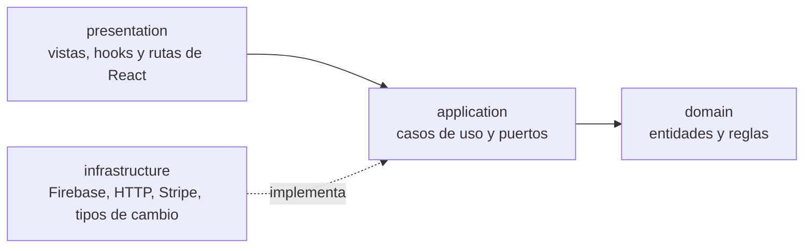

# FrescaGo

[English](README.md) | **Español**

**Frescura directa a tu puerta.**

FrescaGo es una tienda online bilingüe de frutas y verduras frescas. El cliente explora el catálogo, llena el carrito, paga con Stripe y consulta sus pedidos en su cuenta. Sigue las pautas de accesibilidad WCAG 2.2 de nivel AA.

[](https://github.com/srdgz/FrescaGo/actions/workflows/ci.yml)

**Demo:** [frescago.vercel.app](https://frescago.vercel.app). Crea una cuenta para comprar. Los pagos funcionan en el modo de pruebas de Stripe: usa la tarjeta `4242 4242 4242 4242` con cualquier fecha futura y cualquier CVC. No se cobra dinero real.

## Capturas

| Inicio | Tema oscuro |
| --- | --- |
|  |  |

| Catálogo | Producto |
| --- | --- |
|  |  |

| Carrito |
| --- |
|  |

| Móvil: inicio | Móvil: catálogo | Móvil: carrito |
| --- | --- | --- |
|  |  |  |

## Funcionalidades

- **Español e inglés.** El idioma forma parte de la URL (`/es/productos`, `/en/products`), con rutas, nombres y descripciones de producto, títulos de página y etiquetas `hreflang` traducidos.
- **Euro y dólar estadounidense.** Los precios se guardan en euros y se convierten con el tipo de cambio diario del Banco Central Europeo de Frankfurter. Si el servicio falla, un tipo de reserva mantiene la tienda funcionando.
- **Catálogo por categorías** con paginación, productos destacados y una página para cada producto.
- **Carrito** que se conserva entre visitas, con cantidades y un resumen claro.
- **Envío.** Para comprar hace falta una dirección de envío con país ISO. El envío cuesta 4,99 EUR y es gratis cuando el subtotal supera estrictamente los 30 EUR. El coste se cobra en Stripe como una línea propia.
- **Pagos con Stripe Checkout.** El servidor crea la sesión; el navegador solo recibe una URL de redirección.
- **Pedidos.** Cada pedido pagado se guarda en la cuenta del cliente con un número corto (`FG-XXXXXXXX`), los productos, la dirección de envío, la moneda y el tipo de cambio usado.
- **Cuentas con Firebase.** Registro con email y una contraseña que hay que repetir y que debe tener al menos ocho caracteres, perfil con foto e historial de pedidos.
- **Tema claro y oscuro** que sigue al sistema y se puede cambiar desde la cabecera.
- **Accesible y adaptable**, del móvil a pantallas anchas. Ver más abajo.

## Tecnologías

| Capa | Tecnología |
| --- | --- |
| Frontend | React 19, TypeScript, Vite 8, React Router 7, Zustand, Tailwind CSS 4, Framer Motion, react-i18next |
| Backend | Node.js 24, Express 5, TypeScript, Stripe |
| Datos | Firebase Authentication, Firestore y Storage; un catálogo en memoria en el servidor |
| Pruebas | Vitest, Testing Library, axe-core, Supertest |
| Calidad | ESLint (con las reglas de arquitectura aplicadas), TypeScript |
| CI/CD | GitHub Actions, Vercel |
| Servicios | Stripe (modo de pruebas), tipos de cambio de Frankfurter |

## Arquitectura

Tanto el frontend como el backend siguen una arquitectura limpia: las capas internas no conocen las externas. Reglas de ESLint en el frontend y una prueba automática en el backend comprueban que `domain` y `application` nunca importan frameworks ni las capas externas.



- **`domain`**: reglas puras, como el carrito, el coste de envío, la conversión de moneda, la comprobación de contraseñas y la paginación.
- **`application`**: casos de uso y los puertos que describen lo que necesitan del exterior.
- **`infrastructure`**: los adaptadores de Firebase, Stripe, HTTP y tipos de cambio. En el frontend los de Firebase se cargan bajo demanda, así que quien nunca inicia sesión no los descarga.
- **`presentation`** (frontend): vistas, componentes, hooks y rutas. Los casos de uso le llegan por un contexto de React, sin importar nunca la infraestructura.

## Pagos y pedidos

Al navegador nunca se le confía el dinero:

1. El carrito envía solo identificadores de producto, cantidades, el idioma, la moneda y la dirección de envío.
2. El backend reconstruye cada precio con su propio catálogo, añade el coste de envío y crea la sesión de Stripe Checkout. Los productos, el tipo de cambio y la dirección viajan como metadatos de la sesión.
3. Tras pagar, Stripe redirige al cliente a la página de éxito con el identificador de la sesión.
4. El frontend pide esa sesión al backend. El backend la consulta en Stripe y solo responde si está pagada, reconstruyendo el pedido con el catálogo y los metadatos. Una sesión cancelada, sin pagar o desconocida se rechaza.
5. El frontend guarda ese pedido, una sola vez, en la cuenta del cliente.

La clave secreta de Stripe vive solo en el servidor y la API solo acepta peticiones de los orígenes permitidos.

## Accesibilidad, rendimiento y SEO

- Diseñada para WCAG 2.2 nivel AA: un único landmark `main` y un único `h1` por página, enlace para saltar al contenido, formularios con etiquetas y errores asociados a sus campos, paginación usable con teclado, un título para cada página, foco visible y contraste suficiente en ambos temas (una prueba verifica la paleta).
- axe-core revisa todas las pantallas en las pruebas unitarias y también en el navegador, en ambos temas y en tamaños de escritorio y móvil.
- Lighthouse sobre una compilación de producción da 100 en accesibilidad, buenas prácticas y SEO, y entre 98 y 100 en rendimiento en escritorio. En móvil, con la limitación de Lighthouse, el rendimiento está entre 72 y 88: la app es de una sola página, así que no se pinta nada hasta que se ejecuta su JavaScript.
- Las imágenes se sirven en WebP y las fuentes son propias. Las rutas y los adaptadores de Firebase se cargan bajo demanda.
- Incluye `robots.txt`, `sitemap.xml`, enlaces canónicos y de idiomas alternativos, y cabeceras de seguridad (`nosniff`, política de referrer, bloqueo de marcos y política de permisos).

Las comprobaciones automáticas solo detectan una parte de los problemas posibles. Se sigue recomendando una revisión manual con un lector de pantalla.

## Cómo ejecutarlo en local

Necesitas Node 24 o superior, un proyecto de Firebase (Authentication, Firestore y Storage) y una cuenta de Stripe en modo de pruebas.

### Backend

```bash
cd backend
npm install
cp .env.example .env          # en PowerShell: Copy-Item .env.example .env
```

Edita `backend/.env`: pon en `STRIPE_SECRET_KEY` tu clave de pruebas (`sk_test_...`) y en `FRONTEND_URL` el valor `http://localhost:5173` para que Stripe vuelva a tu web local tras pagar. Después:

```bash
npm run dev
```

La API escucha en [http://localhost:8000](http://localhost:8000).

### Frontend

```bash
cd frescaGo
npm install
cp .env.example .env          # en PowerShell: Copy-Item .env.example .env
```

Rellena las variables de Firebase, pon `VITE_USE_LOCAL_API=true` para usar el backend local y ejecuta:

```bash
npm run dev
```

Abre [http://localhost:5173](http://localhost:5173).

### Variables de entorno

| Variable | Dónde | Para qué sirve |
| --- | --- | --- |
| `STRIPE_SECRET_KEY` | backend | Clave secreta de Stripe. No la expongas nunca (obligatoria) |
| `PORT` | backend | Puerto de la API. Por defecto 8000 |
| `FRONTEND_URL` | backend | A dónde devuelve Stripe al cliente |
| `ALLOWED_ORIGINS` | backend | Orígenes permitidos por CORS, separados por comas |
| `FALLBACK_EUR_USD_RATE` | backend | Tipo usado cuando Frankfurter no está disponible |
| `VITE_BASE_URL_PRODUCTION` | frontend | URL de la API desplegada |
| `VITE_BASE_URL_LOCAL` | frontend | URL de la API local |
| `VITE_USE_LOCAL_API` | frontend | `true` para usar la API local |
| `VITE_FIREBASE_*` | frontend | Credenciales de tu app web de Firebase: clave de API, dominio de autenticación, id del proyecto, bucket de almacenamiento, id del remitente e id de la app |

Los archivos `.env` no se versionan. No subas nunca credenciales reales a los `.env.example`.

## Pruebas y calidad

```bash
cd backend
npm run typecheck && npm test
```

```bash
cd frescaGo
npm run lint && npm run typecheck && npm test && npm run build
```

- **Backend:** reglas de dominio, el coste de envío, el caso de uso del pago con una pasarela falsa, la confirmación del pedido, la API HTTP y las capas de la arquitectura.
- **Frontend:** reglas de dominio, adaptadores, componentes, rutas y accesibilidad con axe en cada pantalla.

## CI/CD y despliegue

- **CI** (`.github/workflows/ci.yml`): en cada pull request y en `main`, el backend ejecuta la comprobación de tipos y las pruebas; el frontend ejecuta lint, tipos, pruebas y la compilación.
- **Vercel** despliega el backend (directorio raíz `backend`, una función de Node) y el frontend (directorio raíz `frescaGo`, un sitio estático con una reescritura a `index.html`). Cada push a `main` se despliega automáticamente y cada rama recibe una vista previa.

Para desplegar tu propia copia, importa el repositorio dos veces en Vercel con esos directorios raíz y añade:

- **Backend:** `STRIPE_SECRET_KEY`, `FRONTEND_URL` (la URL del frontend) y `ALLOWED_ORIGINS` (la misma URL).
- **Frontend:** `VITE_BASE_URL_PRODUCTION` (la URL del backend) y las variables `VITE_FIREBASE_*`.

## API

Las rutas de productos aceptan `?lang=es` o `?lang=en`.

| Ruta | Para qué sirve |
| --- | --- |
| `GET /productos`, `GET /productos/:id` | Productos y un producto concreto |
| `GET /categorias`, `GET /categorias/:id` | Categorías y los productos de una categoría |
| `GET /destacados` | Productos destacados |
| `GET /rates` | Tipo de cambio de EUR a USD |
| `POST /checkout` | Crea la sesión de Stripe Checkout y devuelve su URL |
| `GET /checkout/sessions/:id` | El pedido de una sesión pagada, reconstruido en el servidor |

## Limitaciones conocidas

- Los pedidos se escriben en Firestore desde el navegador, después de que el backend confirme el pago. Para hacerlo cumplir de verdad, el backend tendría que escribirlos con `firebase-admin` y las reglas de Firestore denegar las escrituras desde el cliente.
- El catálogo son datos estáticos del servidor, no una base de datos.
- Es una aplicación de una sola página, así que el rendimiento móvil está limitado por el tiempo de ejecutar su JavaScript. Prerenderizar las páginas públicas lo mejoraría.

## Estructura del repositorio

```text
backend/
  src/
    domain/            Reglas de catálogo, moneda, coste de envío y pedido
    application/       Casos de uso y puertos
    infrastructure/    App HTTP, Stripe, tipos de cambio y catálogo
  tests/
frescaGo/
  src/
    domain/            Reglas de carrito, usuario, moneda, paginación y pedido
    application/       Casos de uso y puertos
    infrastructure/    Firebase, pasarelas HTTP y el contenedor
    presentation/      Vistas, componentes, hooks, rutas y traducciones
  public/              Iconos, robots.txt y sitemap.xml
docs/screenshots/      Imágenes usadas en este README
.github/               Workflows
```

## Licencia

Publicado bajo la licencia MIT. Consulta el archivo [LICENSE](LICENSE).
