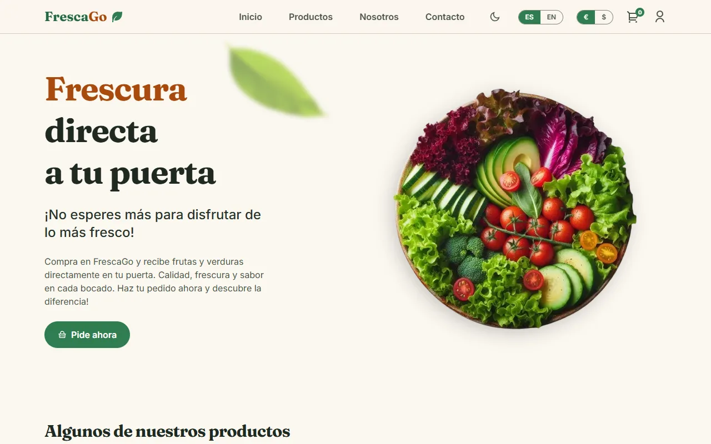
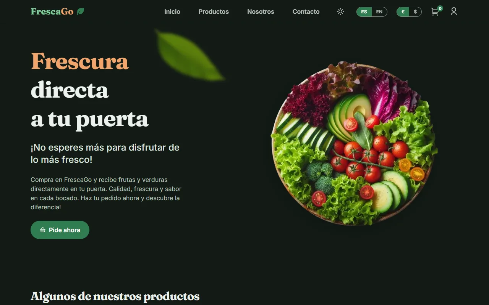
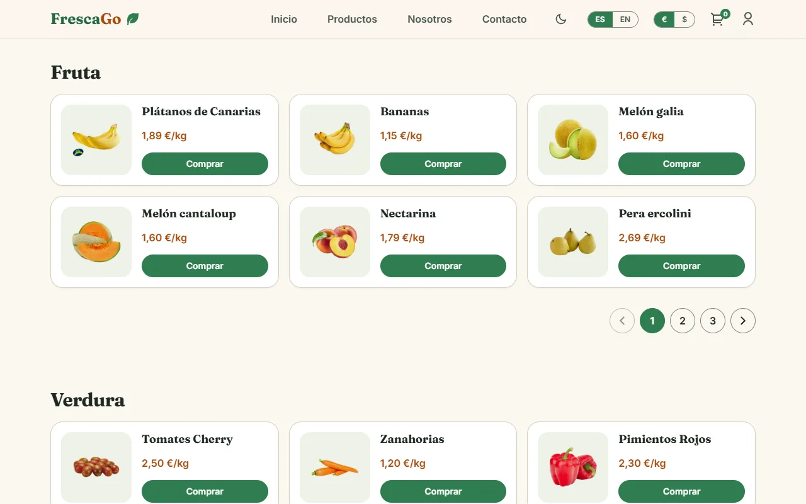
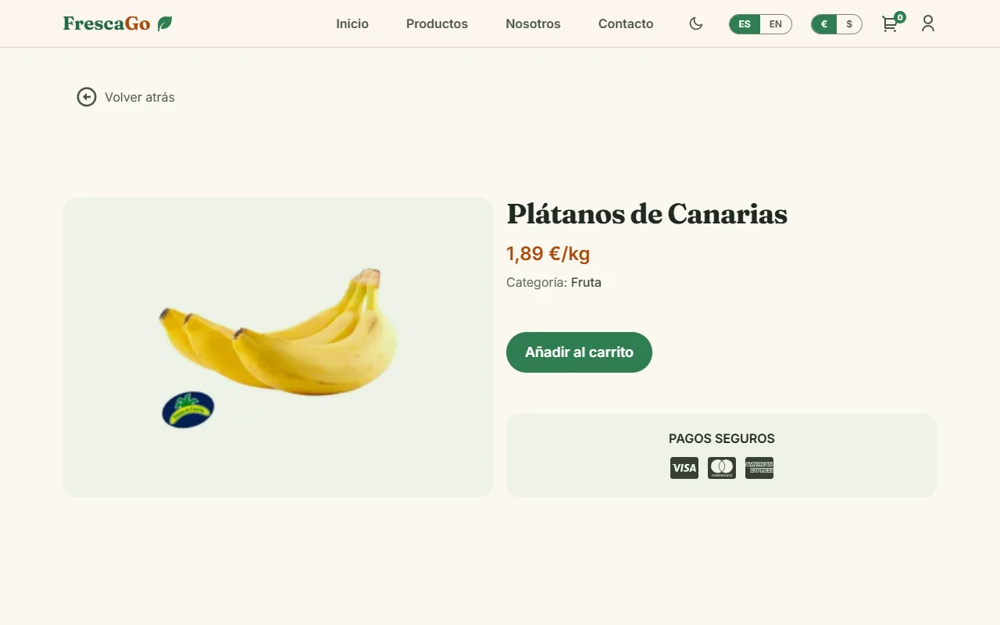
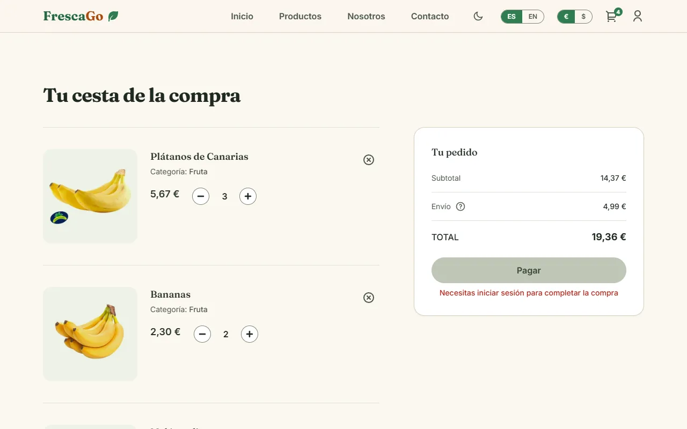
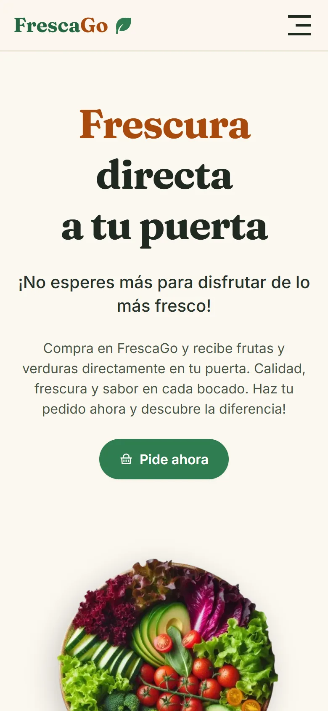
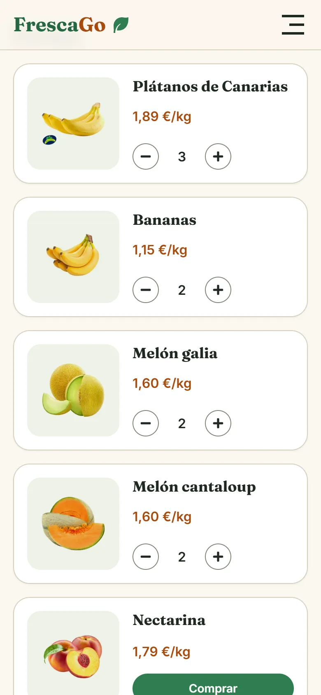
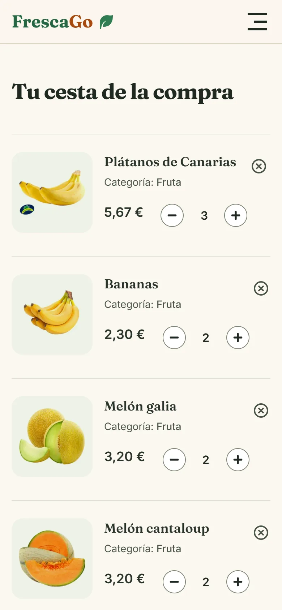
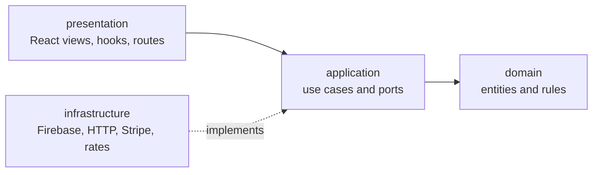

# FrescaGo

**English** | [Español](README.es.md)

**Frescura directa a tu puerta.** (Freshness straight to your door.)

FrescaGo is a bilingual online grocery shop for fresh fruit and vegetables. Customers browse a catalogue, fill a cart, pay with Stripe and follow their orders in their account. It follows the WCAG 2.2 level AA accessibility guidelines.

[](https://github.com/srdgz/FrescaGo/actions/workflows/ci.yml)

**Demo:** [frescago.vercel.app](https://frescago.vercel.app). Create an account to buy. Payments run in Stripe's test mode: use the card `4242 4242 4242 4242` with any future date and any CVC. No real money is charged.

## Screenshots

| Home | Dark theme |
| --- | --- |
|  |  |

| Catalogue | Product |
| --- | --- |
|  |  |

| Cart |
| --- |
|  |

| Mobile: home | Mobile: catalogue | Mobile: cart |
| --- | --- | --- |
|  |  |  |

## Features

- **Spanish and English.** The language is part of the URL (`/es/productos`, `/en/products`), with translated routes, product names and descriptions, page titles and `hreflang` tags.
- **Euro and US dollar.** Prices are stored in euros and converted with the daily European Central Bank rate from Frankfurter. If the service is down, a fallback rate keeps the shop working.
- **Catalogue by category** with pagination, featured products and a page for each product.
- **Cart** that is kept between visits, with quantities and a clear summary.
- **Shipping.** A shipping address with an ISO country is required to buy. Shipping costs 4.99 EUR and is free when the subtotal is strictly above 30 EUR. The fee is charged in Stripe as its own line.
- **Payments with Stripe Checkout.** The server creates the session; the browser only gets a redirect URL.
- **Orders.** Each paid order is saved to the customer's account with a short order number (`FG-XXXXXXXX`), the items, the shipping address, the currency and the rate used.
- **Accounts with Firebase.** Sign up with email and a password that must be repeated and be at least eight characters long, a profile with a picture, and an order history.
- **Light and dark theme** that follows the system and can be changed from the header.
- **Accessible and responsive**, from phones to wide screens. See below.

## Tech stack

| Layer | Technology |
| --- | --- |
| Frontend | React 19, TypeScript, Vite 8, React Router 7, Zustand, Tailwind CSS 4, Framer Motion, react-i18next |
| Backend | Node.js 24, Express 5, TypeScript, Stripe |
| Data | Firebase Authentication, Firestore and Storage; an in-memory catalogue on the server |
| Testing | Vitest, Testing Library, axe-core, Supertest |
| Quality | ESLint (with the architecture rules enforced), TypeScript |
| CI/CD | GitHub Actions, Vercel |
| Services | Stripe (test mode), Frankfurter exchange rates |

## Architecture

Both the frontend and the backend follow a clean architecture: inner layers know nothing about outer ones. ESLint rules on the frontend and an automated test on the backend check that `domain` and `application` never import frameworks or the outer layers.



- **`domain`**: pure rules such as the cart, the shipping fee, the currency conversion, password checks and pagination.
- **`application`**: use cases and the ports that describe what they need from the outside.
- **`infrastructure`**: the Firebase, Stripe, HTTP and exchange rate adapters. On the frontend the Firebase adapters are loaded on demand, so visitors who never sign in do not download them.
- **`presentation`** (frontend): views, components, hooks and routes. Use cases reach it through a React context, never by importing infrastructure.

## Payments and orders

The browser is never trusted with money:

1. The cart sends only product identifiers, quantities, the language, the currency and the shipping address.
2. The backend rebuilds every price from its own catalogue, adds the shipping fee and creates the Stripe Checkout session. The items, the exchange rate and the address travel as session metadata.
3. After paying, Stripe redirects the customer to the success page with the session id.
4. The frontend asks the backend for that session. The backend retrieves it from Stripe and only answers when it is paid, rebuilding the order from the catalogue and the metadata. A cancelled, unpaid or unknown session is rejected.
5. The frontend saves that order, once, in the customer's account.

The Stripe secret key lives only on the server and the API only accepts requests from the allowed origins.

## Accessibility, performance and SEO

- Designed for WCAG 2.2 level AA: one `main` landmark and one `h1` per page, a skip link, labelled forms with errors tied to their fields, a keyboard-friendly pagination, a title for every page, visible focus and sufficient contrast in both themes (a test verifies the palette).
- axe-core checks all the screens in unit tests, and also in the browser in both themes and on desktop and phone sizes.
- Lighthouse on a production build gives 100 in accessibility, best practices and SEO, and 98 to 100 in performance on desktop. On mobile, with Lighthouse's throttling, performance is between 72 and 88: the app is a single page application, so nothing is drawn until its JavaScript runs.
- Images are served as WebP and the fonts are self-hosted. Routes and the Firebase adapters are loaded on demand.
- `robots.txt`, `sitemap.xml`, canonical and alternate language links, and security headers (`nosniff`, referrer policy, frame denial and permissions policy) are included.

Automated checks find only part of the possible problems. A manual review with a screen reader is still recommended.

## Getting started locally

You need Node 24 or later, a Firebase project (Authentication, Firestore and Storage) and a Stripe account in test mode.

### Backend

```bash
cd backend
npm install
cp .env.example .env          # in PowerShell: Copy-Item .env.example .env
```

Edit `backend/.env`: set `STRIPE_SECRET_KEY` to your test key (`sk_test_...`) and `FRONTEND_URL` to `http://localhost:5173` so Stripe returns to your local site after paying. Then:

```bash
npm run dev
```

The API listens on [http://localhost:8000](http://localhost:8000).

### Frontend

```bash
cd frescaGo
npm install
cp .env.example .env          # in PowerShell: Copy-Item .env.example .env
```

Fill in the Firebase variables, set `VITE_USE_LOCAL_API=true` to talk to the local backend, and run:

```bash
npm run dev
```

Open [http://localhost:5173](http://localhost:5173).

### Environment variables

| Variable | Where | Purpose |
| --- | --- | --- |
| `STRIPE_SECRET_KEY` | backend | Stripe secret key. Never expose it (required) |
| `PORT` | backend | Port of the API. Defaults to 8000 |
| `FRONTEND_URL` | backend | Where Stripe sends the customer back to |
| `ALLOWED_ORIGINS` | backend | Origins allowed by CORS, comma separated |
| `FALLBACK_EUR_USD_RATE` | backend | Rate used when Frankfurter is not available |
| `VITE_BASE_URL_PRODUCTION` | frontend | URL of the deployed API |
| `VITE_BASE_URL_LOCAL` | frontend | URL of the local API |
| `VITE_USE_LOCAL_API` | frontend | `true` to use the local API |
| `VITE_FIREBASE_*` | frontend | Credentials of your Firebase web app: API key, auth domain, project id, storage bucket, sender id and app id |

`.env` files are not versioned. Never commit real credentials to the `.env.example` files.

## Tests and quality

```bash
cd backend
npm run typecheck && npm test
```

```bash
cd frescaGo
npm run lint && npm run typecheck && npm test && npm run build
```

- **Backend:** domain rules, the shipping fee, the checkout use case with a fake gateway, the order confirmation, the HTTP API and the architecture layers.
- **Frontend:** domain rules, adapters, components, routes and accessibility with axe on every screen.

## CI/CD and deployment

- **CI** (`.github/workflows/ci.yml`): on every pull request and on `main`, the backend runs type checks and tests; the frontend runs lint, type checks, tests and the build.
- **Vercel** deploys the backend (root directory `backend`, a Node function) and the frontend (root directory `frescaGo`, a static site with a rewrite to `index.html`). Every push to `main` is deployed automatically and every branch gets a preview.

To deploy your own copy, import the repository twice in Vercel with those root directories and add:

- **Backend:** `STRIPE_SECRET_KEY`, `FRONTEND_URL` (the URL of the frontend) and `ALLOWED_ORIGINS` (the same URL).
- **Frontend:** `VITE_BASE_URL_PRODUCTION` (the URL of the backend) and the `VITE_FIREBASE_*` variables.

## API

Product routes accept `?lang=es` or `?lang=en`.

| Route | Purpose |
| --- | --- |
| `GET /productos`, `GET /productos/:id` | Products and a single product |
| `GET /categorias`, `GET /categorias/:id` | Categories and the products of a category |
| `GET /destacados` | Featured products |
| `GET /rates` | EUR to USD exchange rate |
| `POST /checkout` | Creates the Stripe Checkout session and returns its URL |
| `GET /checkout/sessions/:id` | The order of a paid session, rebuilt on the server |

## Known limitations

- Orders are written to Firestore from the browser, after the backend has confirmed the payment. Truly enforcing it would need the backend to write them with `firebase-admin` and Firestore rules that deny client writes.
- The catalogue is static data on the server, not a database.
- It is a single page application, so mobile performance is limited by the time to run its JavaScript. Pre-rendering the public pages would improve it.

## Repository structure

```text
backend/
  src/
    domain/            Catalogue, currency, shipping fee and order rules
    application/       Use cases and ports
    infrastructure/    HTTP app, Stripe, exchange rates and catalogue
  tests/
frescaGo/
  src/
    domain/            Cart, user, currency, pagination and order rules
    application/       Use cases and ports
    infrastructure/    Firebase, HTTP gateways and the container
    presentation/      Views, components, hooks, routes and translations
  public/              Icons, robots.txt and sitemap.xml
docs/screenshots/      Images used in this README
.github/               Workflows
```

## License

Released under the MIT licence. See the [LICENSE](LICENSE) file.
